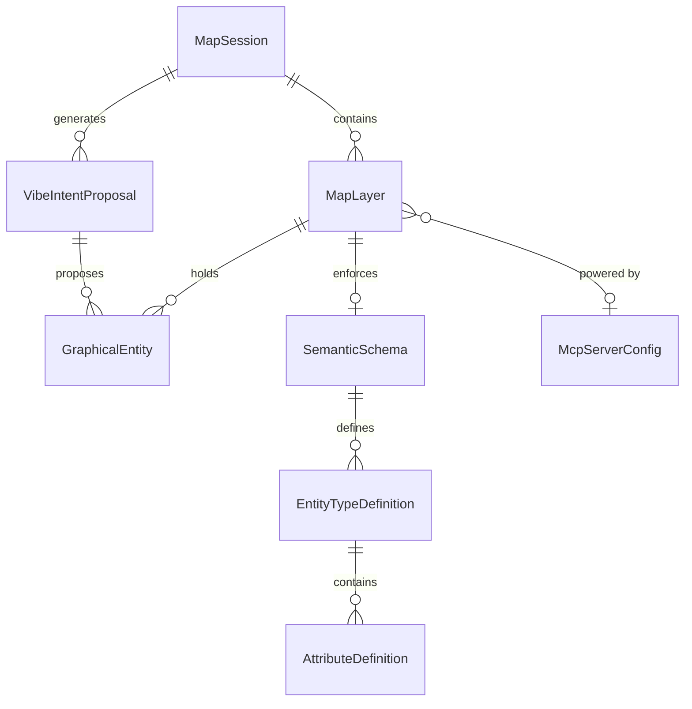

# Data Model: Context-Aware Naturally Vibe AI Sketcher (CANVAiS)

**Feature**: `001-vibe-map-sketcher` | **Date**: 2026-11-02

## Entity Relationship Overview

---

## Entities & Value Objects

### 1. MapSession
Represents an active or persisted collaborative geospatial sketching session.

| Field | Type | Constraints | Description |
|---|---|---|---|
| `id` | `UUID` | Primary Key, Not Null | Unique identifier of the session |
| `title` | `String` | Not Null, Max 120 chars | Human-readable session name |
| `description` | `String` | Nullable, Max 500 chars | Optional context or mission brief |
| `centerLat` | `Double` | Not Null, -90.0 to 90.0 | Latitude of default camera center |
| `centerLng` | `Double` | Not Null, -180.0 to 180.0 | Longitude of default camera center |
| `zoomLevel` | `Integer` | Not Null, 1 to 22 | Initial zoom level of the map |
| `crs` | `String` | Not Null, default "EPSG:4326" | Coordinate Reference System identifier |
| `createdAt` | `Instant` | Not Null | Timestamp of session creation |
| `updatedAt` | `Instant` | Not Null | Timestamp of last modification |
| `layers` | `List<MapLayer>` | Ordered by `orderIndex` | Ordered collection of visual layers |

---

### 2. MapLayer
An organizational and semantic stratum holding related graphical entities.

| Field | Type | Constraints | Description |
|---|---|---|---|
| `id` | `UUID` | Primary Key, Not Null | Unique layer identifier |
| `sessionId` | `UUID` | Foreign Key, Not Null | Parent `MapSession` reference |
| `name` | `String` | Not Null, Max 80 chars | Layer display name |
| `orderIndex` | `Integer` | Not Null, >= 0 | Vertical stacking order (z-index) |
| `visible` | `Boolean` | Not Null, default `true` | Layer visibility toggle |
| `opacity` | `Double` | Not Null, 0.0 to 1.0 | Visual opacity factor |
| `layerType` | `LayerType` | Enum (`STANDARD`, `CUSTOM_SEMANTIC`, `MCP_MANAGED`) | Operational type of layer |
| `schemaId` | `UUID` | Nullable | Referenced `SemanticSchema` |
| `pluginId` | `String` | Nullable | ID of associated MCP server / AI plugin |

---

### 3. GraphicalEntity
A discrete plotted object on a specific layer, combining geometry, style, and domain semantics.

| Field | Type | Constraints | Description |
|---|---|---|---|
| `id` | `UUID` | Primary Key, Not Null | Unique entity identifier |
| `layerId` | `UUID` | Foreign Key, Not Null | Parent `MapLayer` reference |
| `name` | `String` | Nullable, Max 100 chars | Optional entity label |
| `entityType` | `String` | Not Null | Semantic classification (e.g. "ObservationPost") |
| `geometryType` | `GeometryType` | Enum (`POINT`, `LINE_STRING`, `POLYGON`, `MULTI_POLYGON`) | WKT/GeoJSON geometry primitive type |
| `geometry` | `org.locationtech.jts.geom.Geometry` | Not Null | Exact topological spatial geometry in WGS84 |
| `style` | `EntityStyle` | Embedded / JSON | Visual rendering specification (colors, strokes, icons) |
| `semanticAttributes` | `Map<String, Object>` | JSON Map | Key-value pairs validated against the layer schema |
| `confidenceScore` | `Double` | Nullable, 0.0 to 1.0 | AI intent confidence score (if AI synthesized) |
| `provenance` | `ProvenanceType` | Enum (`MANUAL`, `VIBE_AI`, `MCP_PLUGIN`) | Origin of the entity creation |

#### Embedded: EntityStyle
- `strokeColor`: `String` (HEX/RGBA, e.g., `"#E63946"`)
- `fillColor`: `String` (HEX/RGBA, e.g., `"#E6394633"`)
- `strokeWidth`: `Float` (pixels, e.g., `2.5`)
- `dashArray`: `String` (nullable, e.g., `"5, 5"`)
- `icon`: `String` (nullable, standard symbol name)

---

### 4. SemanticSchema & EntityTypeDefinition
Defines domain-specific ontologies and validation rules for custom layers.

| Field | Type | Description |
|---|---|---|
| `id` | `UUID` | Unique schema identifier |
| `name` | `String` | Schema title (e.g. "WildfireEmergencyOntology") |
| `domainCategory` | `String` | Domain classification (e.g., "DisasterRelief", "UrbanPlanning") |
| `version` | `String` | Semantic version of the schema |
| `entityTypes` | `List<EntityTypeDefinition>` | Allowed entity types and their constraints |

#### EntityTypeDefinition
- `name`: `String` (system identifier, e.g., `"TriageArea"`)
- `displayName`: `String` (human-readable, e.g., `"Triage Area"`)
- `allowedGeometries`: `List<GeometryType>` (e.g., `[POLYGON]`)
- `defaultStyle`: `EntityStyle`
- `attributes`: `List<AttributeDefinition>`:
  - `name`: `String`
  - `dataType`: `DataType` (`STRING`, `NUMBER`, `BOOLEAN`, `ENUM`, `DATETIME`)
  - `required`: `Boolean`
  - `allowedValues`: `List<String>` (nullable, for enum constraints)

---

### 5. VibeIntentRequest & VibeIntentProposal
Represents the multimodal input and the AI-generated sketching proposal.

#### VibeIntentRequest (DTO)
- `sessionId`: `UUID` (Target map session)
- `targetLayerId`: `UUID` (Layer receiving the plotted objects)
- `textVibe`: `String` (Typed vibe or transcribed speech text)
- `rawAudio`: `byte[]` (Optional raw audio stream WAV/WebM if transcribing server-side)
- `gestureStrokes`: `List<GesturePoint>` (Array of `{lat, lng, timestampMs}`)
- `viewportBounds`: `BoundingBox` (`{north, south, east, west}`)

#### VibeIntentProposal
| Field | Type | Description |
|---|---|---|
| `proposalId` | `UUID` | Unique proposal identifier |
| `targetLayerId` | `UUID` | Target layer |
| `interpretedSummary` | `String` | Plain English explanation of the AI's spatial interpretation |
| `proposedEntities` | `List<GraphicalEntity>` | Synthesized candidate entities ready for preview |
| `status` | `ProposalStatus` | Enum (`PENDING`, `ACCEPTED`, `REFINED`, `REJECTED`) |
| `createdAt` | `Instant` | Proposal generation timestamp |

---

### 6. McpServerConfig
Tracks configured Model Context Protocol connections.

| Field | Type | Description |
|---|---|---|
| `id` | `String` | Internal identifier / slug |
| `name` | `String` | Display name of the MCP server |
| `transportType` | `TransportType` | `SSE` or `STDIO` |
| `endpointUri` | `String` | SSE URL or executable command path |
| `connectionStatus` | `ConnectionStatus` | `CONNECTED`, `CONNECTING`, `DISCONNECTED`, `ERROR` |
| `lastDiscoveredAt` | `Instant` | Last successful tool/schema discovery timestamp |
| `discoveredTools` | `List<String>` | List of tool names exposed by server |
| `associatedLayerIds` | `List<UUID>` | Layers utilizing this MCP server |
