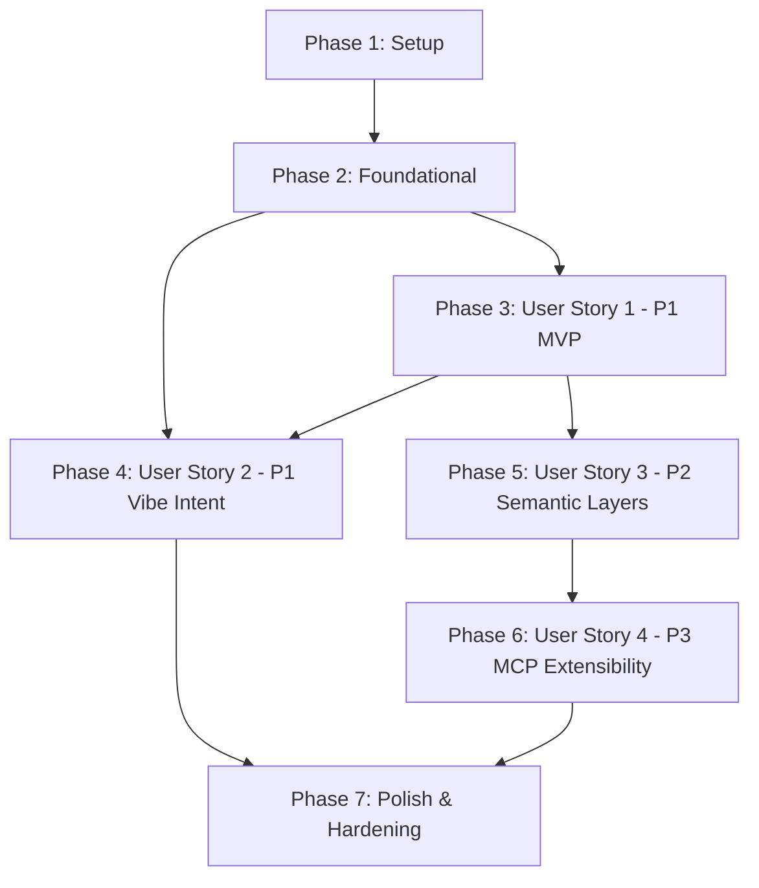

# Tasks: Context-Aware Naturally Vibe AI Sketcher (CANVAiS)

**Input**: Design documents from `specs/001-vibe-map-sketcher/` (`plan.md`, `spec.md`, `data-model.md`, `contracts/`, `research.md`, `quickstart.md`, `.specify/memory/constitution.md`)

**Organization**: Tasks are grouped by phase and user story to enable independent, test-driven implementation and incremental delivery.

## Format: `- [ ] [TaskID] [P?] [Story?] Description with file path`

- **[P]**: Parallelizable task (different files, no blocking dependencies)
- **[Story]**: User story mapping (`[US1]`, `[US2]`, `[US3]`, `[US4]`)
- Exact file paths included for every task

---

## Phase 1: Setup (Shared Infrastructure)

**Purpose**: Initialize the Java 21 Spring Boot project, Gradle build system with Groovy plugin, and quality tooling per CANVAiS Constitution.

- [X] T001 Initialize Gradle build configuration with Java 21, Spring Boot 3.3.x, Groovy plugin, JTS Topology Suite, Springdoc OpenAPI, and JaCoCo in build.gradle
- [X] T002 [P] Configure Gradle multi-language settings and project naming in settings.gradle
- [X] T003 [P] Configure application runtime properties and H2/PostGIS profiles in src/main/resources/application.yml
- [X] T004 [P] Configure Checkstyle linting rules enforcing clean Java code in config/checkstyle/checkstyle.xml
- [X] T005 [P] Configure CodeNarc linting rules for Groovy specifications in config/codenarc/codenarc.xml
- [X] T006 [P] Configure JaCoCo verification gate enforcing 80% minimum line and branch coverage in build.gradle

---

## Phase 2: Foundational (Blocking Prerequisites)

**Purpose**: Core architectural infrastructure that must be complete before any user story can be implemented.

**CRITICAL**: All user story phases depend on this foundation.

- [X] T007 Create main Spring Boot application entry point in src/main/java/com/canvais/CanvaisApplication.java
- [X] T008 [P] Implement global REST exception handler and error response structure in src/main/java/com/canvais/api/exception/GlobalExceptionHandler.java
- [X] T009 [P] Implement JTS Geometry and GeoJSON serialization adapter in src/main/java/com/canvais/infrastructure/geospatial/JtsGeometryAdapter.java
- [X] T010 [P] Implement GeoJSON FeatureCollection converter utility in src/main/java/com/canvais/infrastructure/geospatial/GeoJsonConverter.java
- [X] T011 [P] Create base Spock specification harness for Spring Boot slice and integration tests in src/test/groovy/com/canvais/SpecificationBase.groovy

**Checkpoint**: Foundation ready — user story implementation can proceed.

---

## Phase 3: User Story 1 - Base Map Navigation & Multi-Layer Object Plotting (Priority: P1) [MVP]

**Goal**: Deliver an interactive base map where users can pan, zoom, create/reorder layers, and plot vector objects (points, lines, polygons) tied to real-world coordinates.

**Independent Test**: Launch the application, create a MapSession, add a MapLayer, and plot a polygon via REST API; verify persistence and GeoJSON retrieval as detailed in Scenario 1 & 2 of `quickstart.md`.

### Tests for User Story 1 (Spock Specifications)

- [X] T012 [P] [US1] Create Spock specification testing JTS geometry conversions in src/test/groovy/com/canvais/infrastructure/geospatial/JtsGeometryAdapterSpec.groovy
- [X] T013 [P] [US1] Create Spock specification for MapSessionService and LayerService business logic in src/test/groovy/com/canvais/service/MapSessionServiceSpec.groovy
- [X] T014 [P] [US1] Create Spock WebMvcTest specification for map sessions and layers REST endpoints in src/test/groovy/com/canvais/api/MapSessionControllerSpec.groovy

### Implementation for User Story 1

- [X] T015 [P] [US1] Implement MapSession domain model in src/main/java/com/canvais/domain/model/MapSession.java with constraints: `id` (UUID PK NotNull), `title` (String NotNull Max 120 chars), `description` (String Nullable Max 500 chars), `centerLat` (Double NotNull -90.0 to 90.0), `centerLng` (Double NotNull -180.0 to 180.0), `zoomLevel` (Integer NotNull 1 to 22), `crs` (String NotNull default "EPSG:4326"), `createdAt`/`updatedAt` (Instant NotNull)
- [X] T016 [P] [US1] Implement MapLayer domain model in src/main/java/com/canvais/domain/model/MapLayer.java with constraints: `id` (UUID PK NotNull), `sessionId` (UUID FK NotNull), `name` (String NotNull Max 80 chars), `orderIndex` (Integer NotNull >= 0), `visible` (Boolean NotNull default true), `opacity` (Double NotNull 0.0 to 1.0), `layerType` (Enum STANDARD, CUSTOM_SEMANTIC, MCP_MANAGED), `schemaId` (UUID Nullable), `pluginId` (String Nullable)
- [X] T017 [P] [US1] Implement EntityStyle embedded class in src/main/java/com/canvais/domain/model/EntityStyle.java with fields: `strokeColor` (String HEX/RGBA), `fillColor` (String HEX/RGBA), `strokeWidth` (Float default 2.0), `dashArray` (String Nullable), `icon` (String Nullable)
- [X] T018 [P] [US1] Implement GraphicalEntity domain model in src/main/java/com/canvais/domain/model/GraphicalEntity.java with constraints: `id` (UUID PK NotNull), `layerId` (UUID FK NotNull), `name` (String Nullable Max 100 chars), `entityType` (String NotNull), `geometryType` (Enum POINT, LINE_STRING, POLYGON, MULTI_POLYGON), `geometry` (JTS Geometry NotNull in WGS84), `style` (EntityStyle), `semanticAttributes` (JSON Map), `confidenceScore` (Double Nullable 0.0 to 1.0), `provenance` (Enum MANUAL, VIBE_AI, MCP_PLUGIN)
- [X] T019 [P] [US1] Implement MapSessionRepository, MapLayerRepository, and GraphicalEntityRepository in src/main/java/com/canvais/domain/repository/MapSessionRepository.java, src/main/java/com/canvais/domain/repository/MapLayerRepository.java, and src/main/java/com/canvais/domain/repository/GraphicalEntityRepository.java
- [X] T020 [P] [US1] Create request/response DTOs for map sessions, layers, and entities in src/main/java/com/canvais/api/dto/request/CreateSessionRequest.java, src/main/java/com/canvais/api/dto/request/CreateLayerRequest.java, src/main/java/com/canvais/api/dto/request/CreateEntityRequest.java, src/main/java/com/canvais/api/dto/response/MapSessionResponse.java, and src/main/java/com/canvais/api/dto/response/GraphicalEntityResponse.java
- [X] T021 [US1] Implement MapSessionService and LayerService business methods in src/main/java/com/canvais/service/MapSessionService.java and src/main/java/com/canvais/service/LayerService.java
- [X] T022 [US1] Implement GraphicalEntityService with spatial validation in src/main/java/com/canvais/service/GraphicalEntityService.java
- [X] T023 [US1] Implement MapSessionController and MapLayerController adhering to OpenAPI contract in src/main/java/com/canvais/api/controller/MapSessionController.java and src/main/java/com/canvais/api/controller/MapLayerController.java
- [X] T024 [P] [US1] Create web map HTML structure and canvas viewport in src/main/resources/static/index.html and src/main/resources/static/css/styles.css
- [X] T025 [US1] Implement interactive map renderer supporting panning, zooming, and layer toggles in src/main/resources/static/js/map-renderer.js

**Checkpoint**: User Story 1 complete — base multi-layer map plotting functions independently as an MVP.

---

## Phase 4: User Story 2 - Multimodal Vibe & Freehand Intent Fusion (Priority: P1)

**Goal**: Enable users to speak or type natural language intent ("vibe") while drawing freehand gestures on the canvas, synthesizing context-aware vector objects into the target layer.

**Independent Test**: Submit a mock audio recording or text vibe alongside gesture stroke coordinates; verify that a valid proposal is generated, can be previewed, and committed to the layer as in Scenario 3 of `quickstart.md`.

### Tests for User Story 2 (Spock Specifications)

- [X] T026 [P] [US2] Create Spock specification testing speech transcription adapter in src/test/groovy/com/canvais/infrastructure/ai/SpeechTranscriptionAdapterSpec.groovy
- [X] T027 [P] [US2] Create Spock specification testing spatial reasoning prompt generation in src/test/groovy/com/canvais/infrastructure/ai/SpatialReasoningAdapterSpec.groovy
- [X] T028 [P] [US2] Create Spock specification for VibeIntentFusionService orchestration in src/test/groovy/com/canvais/service/VibeIntentFusionServiceSpec.groovy
- [X] T029 [P] [US2] Create Spock WebMvcTest specification for vibe propose and accept endpoints in src/test/groovy/com/canvais/api/VibeIntentControllerSpec.groovy

### Implementation for User Story 2

- [X] T030 [P] [US2] Implement VibeIntentProposal domain model in src/main/java/com/canvais/domain/model/VibeIntentProposal.java with fields: `proposalId` (UUID PK), `targetLayerId` (UUID), `interpretedSummary` (String), `proposedEntities` (List<GraphicalEntity>), `status` (Enum PENDING, ACCEPTED, REFINED, REJECTED), `createdAt` (Instant)
- [X] T031 [P] [US2] Create request and response DTOs for vibe propose, accept, and transcription in src/main/java/com/canvais/api/dto/request/VibeIntentProposeRequest.java, src/main/java/com/canvais/api/dto/request/AcceptProposalRequest.java, and src/main/java/com/canvais/api/dto/response/VibeIntentProposalResponse.java
- [X] T032 [P] [US2] Implement SpeechTranscriptionAdapter for audio stream parsing and fallback transcription in src/main/java/com/canvais/infrastructure/ai/SpeechTranscriptionAdapter.java
- [X] T033 [P] [US2] Implement SpatialReasoningAdapter to fuse vibe description, gesture coordinate bounding box, and target layer schema into candidate GeoJSON entities in src/main/java/com/canvais/infrastructure/ai/SpatialReasoningAdapter.java
- [X] T034 [US2] Implement VibeIntentFusionService to manage proposal lifecycles and layer commitments in src/main/java/com/canvais/service/VibeIntentFusionService.java
- [X] T035 [US2] Implement VibeIntentController exposing `/api/v1/vibe/propose`, `/api/v1/vibe/transcribe`, and `/api/v1/vibe/proposals/{id}/accept` in src/main/java/com/canvais/api/controller/VibeIntentController.java
- [X] T036 [P] [US2] Implement freehand gesture recorder capturing pointer/touch coordinate sequences in src/main/resources/static/js/gesture-recorder.js
- [X] T037 [P] [US2] Implement audio recording client with microphone capture and text fallback in src/main/resources/static/js/vibe-audio.js
- [X] T038 [US2] Implement proposal preview overlay with accept/reject controls in src/main/resources/static/js/proposal-reviewer.js

**Checkpoint**: User Story 2 complete — multimodal vibe and freehand gesture intent fusion works end-to-end.

---

## Phase 5: User Story 3 - Custom Semantic Layers & Specialized Object Ontologies (Priority: P2)

**Goal**: Allow domain experts to configure custom layers with tailored entity types, required attributes, validation constraints, and visual styling rules.

**Independent Test**: Register a custom semantic schema via API, create a layer bound to that schema, plot an entity, and verify schema attribute validation rules are enforced.

### Tests for User Story 3 (Spock Specifications)

- [X] T039 [P] [US3] Create Spock specification testing SemanticSchema validation and entity constraint checking in src/test/groovy/com/canvais/domain/SemanticSchemaSpec.groovy
- [X] T040 [P] [US3] Create Spock WebMvcTest specification for schema management REST endpoints in src/test/groovy/com/canvais/api/SemanticSchemaControllerSpec.groovy

### Implementation for User Story 3

- [X] T041 [P] [US3] Implement SemanticSchema, EntityTypeDefinition, and AttributeDefinition models in src/main/java/com/canvais/domain/model/SemanticSchema.java, src/main/java/com/canvais/domain/model/EntityTypeDefinition.java, and src/main/java/com/canvais/domain/model/AttributeDefinition.java with constraints: `name` (String NotNull), `dataType` (Enum STRING, NUMBER, BOOLEAN, ENUM, DATETIME), `required` (Boolean), `allowedValues` (List<String> Nullable)
- [X] T042 [P] [US3] Implement SemanticSchemaRepository in src/main/java/com/canvais/domain/repository/SemanticSchemaRepository.java
- [X] T043 [P] [US3] Create request/response DTOs for schema registration in src/main/java/com/canvais/api/dto/request/CreateSemanticSchemaRequest.java and src/main/java/com/canvais/api/dto/response/SemanticSchemaResponse.java
- [X] T044 [US3] Implement SemanticSchemaService to validate entity attributes against layer schema definitions in src/main/java/com/canvais/service/SemanticSchemaService.java
- [X] T045 [US3] Implement SemanticSchemaController for schema catalog management in src/main/java/com/canvais/api/controller/SemanticSchemaController.java
- [X] T046 [US3] Implement custom layer ontology creation UI dialog in src/main/resources/static/js/schema-manager.js

**Checkpoint**: User Story 3 complete — custom semantic layers and schema validation function independently.

---

## Phase 6: User Story 4 - Extensibility via AI Skill Plugins & MCP Integrations (Priority: P3)

**Goal**: Integrate Model Context Protocol (MCP) servers and AI skill plugins to discover external tool palettes, fetch domain schemas, and execute specialized plotting actions.

**Independent Test**: Register an MCP server connection, execute discovery, and verify tools/schemas are mapped into CANVAiS layer options as shown in Scenario 4 of `quickstart.md`.

### Tests for User Story 4 (Spock Specifications)

- [X] T047 [P] [US4] Create Spock specification testing MCP client SSE/Stdio communication protocol in src/test/groovy/com/canvais/infrastructure/mcp/McpClientAdapterSpec.groovy
- [X] T048 [P] [US4] Create Spock specification for McpIntegrationService server lifecycle and tool discovery in src/test/groovy/com/canvais/service/McpIntegrationServiceSpec.groovy
- [X] T049 [P] [US4] Create Spock WebMvcTest specification for MCP integration REST endpoints in src/test/groovy/com/canvais/api/McpIntegrationControllerSpec.groovy

### Implementation for User Story 4

- [X] T050 [P] [US4] Implement McpServerConfig domain model in src/main/java/com/canvais/domain/model/McpServerConfig.java with fields: `id` (String PK), `name` (String NotNull), `transportType` (Enum SSE, STDIO), `endpointUri` (String NotNull), `connectionStatus` (Enum CONNECTED, CONNECTING, DISCONNECTED, ERROR), `lastDiscoveredAt` (Instant), `discoveredTools` (List<String>), `associatedLayerIds` (List<UUID>)
- [X] T051 [P] [US4] Implement McpServerConfigRepository in src/main/java/com/canvais/domain/repository/McpServerConfigRepository.java
- [X] T052 [P] [US4] Create DTOs for MCP server registration, discovery, and tool invocation in src/main/java/com/canvais/api/dto/request/RegisterMcpServerRequest.java, src/main/java/com/canvais/api/dto/response/McpServerStatusResponse.java, and src/main/java/com/canvais/api/dto/response/McpDiscoveryResponse.java
- [X] T053 [P] [US4] Implement McpClientAdapter providing JSON-RPC 2.0 transport over SSE and Stdio in src/main/java/com/canvais/infrastructure/mcp/McpClientAdapter.java
- [X] T054 [US4] Implement McpIntegrationService orchestrating discovery, schema mapping, and fallback resilience in src/main/java/com/canvais/service/McpIntegrationService.java
- [X] T055 [US4] Implement McpIntegrationController exposing `/api/v1/integrations/mcp` endpoints in src/main/java/com/canvais/api/controller/McpIntegrationController.java
- [X] T056 [US4] Implement MCP server connection and tool status UI dashboard in src/main/resources/static/js/mcp-settings.js

**Checkpoint**: User Story 4 complete — MCP server extensibility and dynamic schema discovery are fully active.

---

## Phase 7: Polish & Cross-Cutting Concerns

**Purpose**: Quality hardening, complete documentation, and verification against the CANVAiS Constitution.

- [X] T057 [P] Add comprehensive Javadoc and GroovyDoc on all public classes, methods, and record contracts
- [X] T058 [P] Configure Springdoc OpenAPI annotations and verify Swagger UI documentation at `/swagger-ui.html`
- [X] T059 Run `./gradlew check` to verify zero Checkstyle errors, zero CodeNarc violations, and passing Spock test suites
- [X] T060 Verify JaCoCo coverage report meets or exceeds the required 80% line and branch threshold in build/reports/jacoco/test/html/index.html
- [X] T061 Execute and validate all four end-to-end scenarios from specs/001-vibe-map-sketcher/quickstart.md

---

## Dependencies & Execution Order

### Phase Dependencies

### User Story Dependencies

- **User Story 1 (P1)**: Starts immediately after Phase 2 (Foundational). Has no dependencies on other stories. Serves as the MVP.
- **User Story 2 (P1)**: Depends on Phase 2 and uses models/layers from User Story 1 to commit synthesized objects.
- **User Story 3 (P2)**: Extends layer models from User Story 1 with custom ontology schemas and attribute constraints.
- **User Story 4 (P3)**: Extends custom layer capabilities from User Story 3 with external MCP server discovery.

### Parallel Opportunities

- **Phase 1 (Setup)**: Tasks T002, T003, T004, T005, T006 can run in parallel.
- **Phase 2 (Foundational)**: Tasks T008, T009, T010, T011 can run in parallel.
- **Phase 3 (User Story 1)**:
  - Spock tests (T012, T013, T014) can be authored in parallel before implementation.
  - Domain models (T015, T016, T017, T018), Repositories (T019), and DTOs (T020) can be created in parallel.
  - Frontend canvas template (T024) can run in parallel with backend services.
- **Phase 4 (User Story 2)**:
  - Tests (T026, T027, T028, T029) can run in parallel.
  - Domain models (T030), DTOs (T031), Speech adapter (T032), and Spatial adapter (T033) can be built in parallel.
  - Gesture recorder (T036) and Audio client (T037) can run in parallel.

---

## Implementation Strategy

### MVP First (Phases 1, 2, and 3)
1. Complete Phase 1: Setup (build.gradle, tooling, JaCoCo, CodeNarc, Checkstyle).
2. Complete Phase 2: Foundational (Application, JTS Geometry adapter, GlobalExceptionHandler).
3. Complete Phase 3: User Story 1 (MapSession, MapLayer, GraphicalEntity, REST controllers, interactive map frontend).
4. **Validate MVP**: Run `./gradlew test` and test Scenario 1 & 2 in `quickstart.md`. Deploy/demo viable MVP!

### Incremental Feature Additions
1. Add Phase 4: User Story 2 (Speech transcription, spatial reasoning, proposal preview/accept).
2. Add Phase 5: User Story 3 (Semantic schemas, attribute validation, ontology manager).
3. Add Phase 6: User Story 4 (MCP server SSE/Stdio adapter, tool discovery, dynamic layer plugins).
4. Run Phase 7: Polish & Hardening (Javadoc verification, JaCoCo 80%+ threshold check, quickstart validation).
