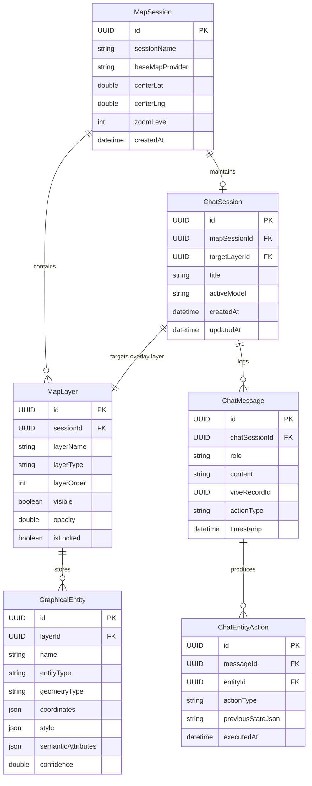
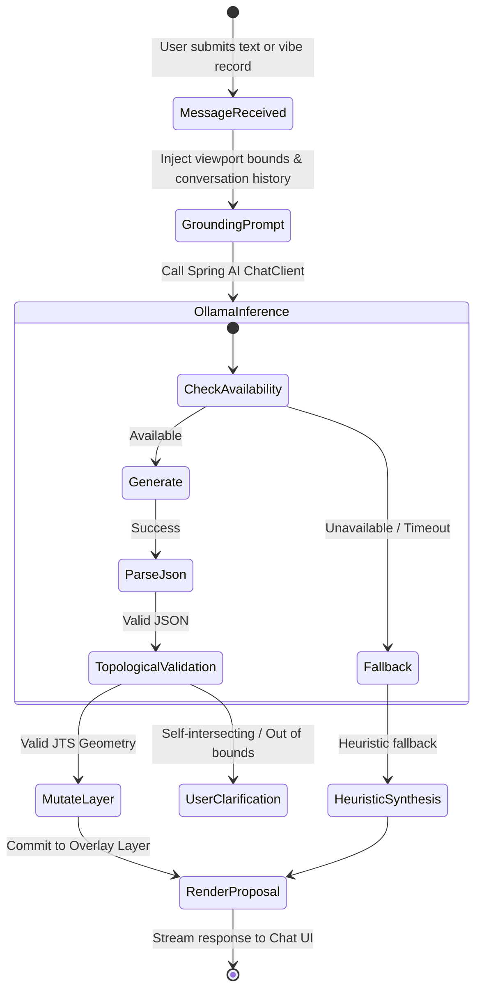

# Phase 1 Data Model: Local AI Chat Layer Sketching

**Feature**: Chat-Assisted Layer Sketching with Local AI  
**Branch**: `002-ollama-chat-layer`  
**Date**: 2026-11-09  

---

## 1. Entity-Relationship Overview



---

## 2. Entities & Value Objects Specification

### 2.1 ChatSession (Entity)
Represents a dedicated conversational thread scoped to a specific `MapSession`.

| Field | Type | Nullable | Description | Validation Rules |
|---|---|---|---|---|
| `id` | `UUID` | No | Primary Key | Auto-generated UUIDv4 |
| `mapSessionId` | `UUID` | No | Foreign Key to `MapSession` | Must reference an existing `MapSession` |
| `targetLayerId` | `UUID` | No | Foreign Key to `MapLayer` (Chat Overlay Layer) | Must reference an active layer with `layerType = 'OVERLAY'` |
| `title` | `String` | No | Session display title | 1–100 characters; defaults to "Chat Sketching Session" |
| `activeModel` | `String` | No | Ollama model name in use | e.g., `llama3.2`, `mistral`; defaults to configured property |
| `createdAt` | `Instant` | No | Session creation timestamp | UTC ISO-8601 |
| `updatedAt` | `Instant` | No | Last interaction timestamp | UTC ISO-8601 |

---

### 2.2 ChatMessage (Entity)
Represents an individual utterance within a conversational sketch session.

| Field | Type | Nullable | Description | Validation Rules |
|---|---|---|---|---|
| `id` | `UUID` | No | Primary Key | Auto-generated UUIDv4 |
| `chatSessionId` | `UUID` | No | Foreign Key to `ChatSession` | Must reference an active `ChatSession` |
| `role` | `ChatRole` (Enum) | No | Speaker role | `USER`, `ASSISTANT`, `SYSTEM` |
| `content` | `String` | No | Message text / assistant narrative | Non-empty, max 4,000 characters |
| `vibeRecordId` | `UUID` | Yes | Reference to source vibe record | Optional; set when triggered from a recorded vibe |
| `actionType` | `ChatActionType` (Enum) | No | Spatial action executed | `CREATE`, `UPDATE`, `DELETE`, `QUERY`, `NONE` |
| `metadata` | `Map<String, Object>` | Yes | Extended diagnostics | Confidence, tokens, execution time |
| `timestamp` | `Instant` | No | Time message was recorded | UTC ISO-8601 |

---

### 2.3 ChatEntityAction (Value Object / Audit Entity)
Tracks modifications applied to `GraphicalEntity` instances during a chat turn, enabling multi-turn refinement, auditability, and undo/redo operations.

| Field | Type | Nullable | Description | Validation Rules |
|---|---|---|---|---|
| `id` | `UUID` | No | Primary Key | Auto-generated UUIDv4 |
| `messageId` | `UUID` | No | Foreign Key to `ChatMessage` | Associated message turn |
| `entityId` | `UUID` | No | Foreign Key to `GraphicalEntity` | Target graphical entity |
| `actionType` | `ChatActionType` (Enum) | No | Modification type | `CREATE`, `UPDATE`, `DELETE` |
| `previousStateJson` | `String` | Yes | Snapshot before update/delete | Valid JSON serialized `GraphicalEntity` snapshot |
| `executedAt` | `Instant` | No | Execution timestamp | UTC ISO-8601 |

---

### 2.4 ChatSpatialContext (Value Object)
Transient payload sent with user messages providing geographic context for grounding the local LLM.

```json
{
  "viewportBounds": {
    "north": 48.2100,
    "south": 48.1500,
    "east": 8.2500,
    "west": 8.1500
  },
  "centerCoordinates": {
    "lat": 48.1800,
    "lng": 8.2000
  },
  "currentZoom": 12,
  "activeOverlayLayerId": "3fa85f64-5717-4562-b3fc-2c963f66afa6"
}
```

---

## 3. Enumerations

### 3.1 ChatRole
- `USER`: The human operator interacting via the chat box.
- `ASSISTANT`: The local AI model responding with spatial interpretations.
- `SYSTEM`: System-level notices (e.g., service disconnection, layer provisioning).

### 3.2 ChatActionType
- `CREATE`: New graphical entity/entities synthesized and added to the overlay layer.
- `UPDATE`: Existing entity geometry, symbology, or metadata modified.
- `DELETE`: Existing entity removed from the overlay layer.
- `QUERY`: Spatial question answered without mutating layer objects.
- `NONE`: Conversational chit-chat or clarification question without spatial changes.

### 3.3 AiServiceStatus
- `AVAILABLE`: Local Ollama service is reachable and model is loaded.
- `BUSY`: Local model is executing an inference task.
- `DEGRADED`: Ollama is reachable but requested model is missing or slow.
- `UNAVAILABLE`: Local Ollama connection refused or timed out.

---

## 4. State Transitions

### 4.1 Chat Turn Lifecycle

