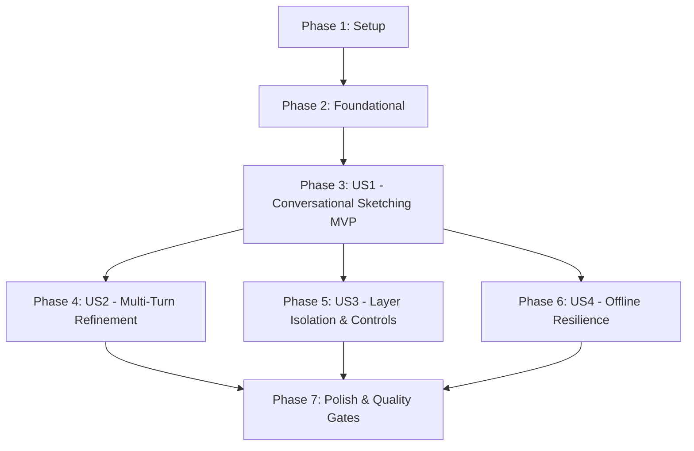

# Tasks: Chat-Assisted Layer Sketching with Local AI

**Input**: Design documents from `specs/002-ollama-chat-layer/` (`plan.md`, `spec.md`, `data-model.md`, `contracts/chat-service-api.yaml`, `research.md`, `quickstart.md`, `.specify/memory/constitution.md`)

**Organization**: Tasks are grouped by phase and user story to enable independent, test-driven implementation and incremental delivery.

## Format: `- [ ] [TaskID] [P?] [Story?] Description with file path`

- **[P]**: Parallelizable task (different files, no blocking dependencies)
- **[Story]**: User story mapping (`[US1]`, `[US2]`, `[US3]`, `[US4]`)
- Exact file paths included for every task

---

## Phase 1: Setup (Shared Infrastructure)

**Purpose**: Add Spring AI dependencies, configure local Ollama runtime endpoints, and set up quality tooling per CANVAiS Constitution.

- [X] T001 Add Spring AI BOM `org.springframework.ai:spring-ai-bom:1.0.0-M6` and starter dependency `org.springframework.ai:spring-ai-starter-model-ollama` in build.gradle
- [X] T002 [P] Configure Ollama connection properties (`base-url: http://localhost:11434`, `model: llama3.2`, timeout: 30s) and overlay layer defaults in src/main/resources/application.yml
- [X] T003 [P] Verify and update Checkstyle and CodeNarc configurations for Spring AI and chat packages in config/checkstyle/checkstyle.xml and config/codenarc/codenarc.xml

---

## Phase 2: Foundational (Blocking Prerequisites)

**Purpose**: Core domain models, enums, repositories, and shared adapter interfaces that must be complete before any user story can be implemented.

**CRITICAL**: All user story phases depend on this foundation.

- [X] T004 [P] Implement ChatRole enum with values `USER`, `ASSISTANT`, `SYSTEM` in src/main/java/com/canvais/domain/model/ChatRole.java
- [X] T005 [P] Implement ChatActionType enum with values `CREATE`, `UPDATE`, `DELETE`, `QUERY`, `NONE` in src/main/java/com/canvais/domain/model/ChatActionType.java
- [X] T006 [P] Implement AiServiceStatus enum with values `AVAILABLE`, `BUSY`, `DEGRADED`, `UNAVAILABLE` in src/main/java/com/canvais/domain/model/AiServiceStatus.java
- [X] T007 [P] Implement ChatSession entity with constraints: `id` (UUID PK NotNull), `mapSessionId` (UUID FK NotNull referencing MapSession), `targetLayerId` (UUID FK NotNull referencing MapLayer with layerType = 'OVERLAY'), `title` (String NotNull 1–100 chars default 'Chat Sketching Session'), `activeModel` (String NotNull default 'llama3.2'), `createdAt` (Instant NotNull UTC ISO-8601), `updatedAt` (Instant NotNull UTC ISO-8601) in src/main/java/com/canvais/domain/model/ChatSession.java
- [X] T008 [P] Implement ChatMessage entity with constraints: `id` (UUID PK NotNull), `chatSessionId` (UUID FK NotNull referencing ChatSession), `role` (ChatRole NotNull), `content` (String NotNull 1–4000 chars), `vibeRecordId` (UUID Nullable), `actionType` (ChatActionType NotNull default NONE), `metadata` (String Nullable max 2000 chars), `timestamp` (Instant NotNull UTC ISO-8601) in src/main/java/com/canvais/domain/model/ChatMessage.java
- [X] T009 [P] Implement ChatEntityAction entity with constraints: `id` (UUID PK NotNull), `messageId` (UUID FK NotNull referencing ChatMessage), `entityId` (UUID FK NotNull referencing GraphicalEntity), `actionType` (ChatActionType NotNull), `previousStateJson` (String Nullable max 4000 chars), `executedAt` (Instant NotNull UTC ISO-8601) in src/main/java/com/canvais/domain/model/ChatEntityAction.java
- [X] T010 [P] Implement ChatSessionRepository and ChatMessageRepository in src/main/java/com/canvais/domain/repository/ChatSessionRepository.java and src/main/java/com/canvais/domain/repository/ChatMessageRepository.java
- [X] T011 [P] Implement ChatEntityActionRepository in src/main/java/com/canvais/domain/repository/ChatEntityActionRepository.java
- [X] T012 [P] Create DTOs for chat requests and responses (`CreateChatSessionRequest`, `SendChatMessageRequest`, `IngestVibeToChatRequest`, `ChatMessageDto`, `ChatMessageTurnResponse`, `ChatSessionResponse`, `ChatSessionDetailResponse`, `AiHealthResponse`) in src/main/java/com/canvais/api/dto/request/ and src/main/java/com/canvais/api/dto/response/
- [X] T013 [P] Define AiModelClientAdapter interface for LLM spatial reasoning and structured entity generation in src/main/java/com/canvais/infrastructure/ai/AiModelClientAdapter.java

**Checkpoint**: Foundation ready — user story implementation can proceed.

---

## Phase 3: User Story 1 - Conversational Sketching via Chat & Vibe Input (Priority: P1) [MVP]

**Goal**: Enable users to describe spatial features conversationally or forward vibe record inputs, prompting the local Ollama LLM to synthesize vector graphical objects onto a dedicated overlay layer above the base map.

**Independent Test**: Start a map session, initialize a chat conversation, submit a prompt ("Draw a perimeter around central park"), and verify that a valid polygon entity is created on the overlay layer while the base map remains untouched, as described in Scenarios 2, 3, and 4 of `quickstart.md`.

### Tests for User Story 1 (Spock Specifications)

- [X] T014 [P] [US1] Create Spock specification testing OllamaChatModelAdapter prompt structuring and GeoJSON parsing in src/test/groovy/com/canvais/infrastructure/ai/OllamaChatModelAdapterSpec.groovy
- [X] T015 [P] [US1] Create Spock specification for ChatService session creation, overlay layer provisioning, and entity creation in src/test/groovy/com/canvais/service/ChatServiceSpec.groovy
- [X] T016 [P] [US1] Create Spock WebMvcTest specification for ChatController endpoints (`/api/v1/chat/sessions`, `/api/v1/chat/sessions/{id}/messages`, `/api/v1/chat/sessions/{id}/vibe`) in src/test/groovy/com/canvais/api/ChatControllerSpec.groovy

### Implementation for User Story 1

- [X] T017 [US1] Implement OllamaChatModelAdapter implementing AiModelClientAdapter using Spring AI ChatModel and JSON Schema prompt for spatial primitive generation in src/main/java/com/canvais/infrastructure/ai/OllamaChatModelAdapter.java
- [X] T018 [US1] Implement ChatService business methods for initializing chat sessions, auto-provisioning dedicated overlay layers (`layerType = OVERLAY`, `orderIndex = 100`), grounding prompts with viewport bounds, and committing graphical entities to the overlay layer in src/main/java/com/canvais/service/ChatService.java
- [X] T019 [US1] Implement vibe record ingestion bridge in ChatService converting VibeIntent transcription and gesture coordinates into chat prompt turns in src/main/java/com/canvais/service/ChatService.java
- [X] T020 [US1] Implement ChatController exposing `/api/v1/chat/sessions`, `/api/v1/chat/sessions/{id}`, `/api/v1/chat/sessions/{id}/messages`, and `/api/v1/chat/sessions/{id}/vibe` conforming to OpenAPI contract in src/main/java/com/canvais/api/controller/ChatController.java
- [X] T021 [P] [US1] Add collapsible chat panel UI layout and messaging feed container to src/main/resources/static/index.html and style in src/main/resources/static/css/styles.css
- [X] T022 [US1] Implement frontend chat client with message sending, streaming response rendering, and canvas overlay rendering integration in src/main/resources/static/js/chat-panel.js
- [X] T023 [US1] Connect existing vibe audio recorder in `vibe-audio.js` with `chat-panel.js` to allow one-click forwarding of vibe recordings into the chat panel in src/main/resources/static/js/vibe-audio.js and src/main/resources/static/js/chat-panel.js

**Checkpoint**: User Story 1 complete — conversational sketching and vibe ingestion into the dedicated overlay layer works end-to-end as an MVP.

---

## Phase 4: User Story 2 - Iterative Modification & Follow-Up Refinement (Priority: P2)

**Goal**: Support multi-turn conversational context so users can refine, restyle, reposition, or delete existing sketched entities on the overlay layer without retyping full requests.

**Independent Test**: Sketch an initial shape, submit a follow-up refinement message ("Change the perimeter line color to red and rename it High Security Zone"), and verify the entity updates in-place on the overlay layer without generating duplicates, as described in Scenario 5 of `quickstart.md`.

### Tests for User Story 2 (Spock Specifications)

- [X] T024 [P] [US2] Create Spock specification testing multi-turn context preservation and entity update/delete actions in src/test/groovy/com/canvais/service/ChatServiceMultiTurnSpec.groovy
- [X] T025 [P] [US2] Create Spock specification testing ChatEntityAction audit logging and previous state snapshots in src/test/groovy/com/canvais/service/ChatEntityActionSpec.groovy

### Implementation for User Story 2

- [X] T026 [US2] Extend OllamaChatModelAdapter to inject previous conversation messages and existing overlay entities into the LLM system prompt context in src/main/java/com/canvais/infrastructure/ai/OllamaChatModelAdapter.java
- [X] T027 [US2] Implement entity modification (`actionType = UPDATE`) and entity deletion (`actionType = DELETE`) logic with `ChatEntityAction` audit logging in src/main/java/com/canvais/service/ChatService.java
- [X] T028 [US2] Update ChatController response handling to return modified or removed entity IDs in `ChatMessageTurnResponse` in src/main/java/com/canvais/api/controller/ChatController.java
- [X] T029 [US2] Update `chat-panel.js` to display interactive confirmation cards for modified objects with undo/re-vibe affordances in src/main/resources/static/js/chat-panel.js

**Checkpoint**: User Story 2 complete — multi-turn conversational updates and deletions functional.

---

## Phase 5: User Story 3 - Layer Isolation & Visual Layer Controls (Priority: P2)

**Goal**: Ensure all chat-generated objects strictly reside within the dedicated overlay layer, allowing users to toggle visibility, adjust opacity, clear, or export the overlay layer without affecting base map tiles.

**Independent Test**: Draw several chat objects, toggle overlay layer visibility, clear the overlay layer via `DELETE /api/v1/chat/sessions/{id}/layer`, and verify that base map tiles remain fully intact, as described in Scenario 6 of `quickstart.md`.

### Tests for User Story 3 (Spock Specifications)

- [X] T030 [P] [US3] Create Spock specification testing overlay layer isolation, clearing, and GeoJSON export in src/test/groovy/com/canvais/service/ChatOverlayLayerSpec.groovy
- [X] T031 [P] [US3] Create Spock WebMvcTest specification for layer clear endpoint in src/test/groovy/com/canvais/api/ChatLayerControllerSpec.groovy

### Implementation for User Story 3

- [X] T032 [US3] Implement `clearOverlayLayer` method in ChatService deleting all `GraphicalEntity` instances linked to the session's `targetLayerId` while retaining layer metadata in src/main/java/com/canvais/service/ChatService.java
- [X] T033 [US3] Expose `DELETE /api/v1/chat/sessions/{chatSessionId}/layer` endpoint returning `ClearLayerResponse` in src/main/java/com/canvais/api/controller/ChatController.java
- [X] T034 [P] [US3] Add overlay layer visibility toggle, opacity control, and "Clear Chat Drawings" button into the chat panel toolbar in src/main/resources/static/index.html and src/main/resources/static/js/chat-panel.js
- [X] T035 [US3] Integrate overlay layer visibility and opacity changes with `map-renderer.js` to ensure real-time canvas updates without redrawing base map tiles in src/main/resources/static/js/map-renderer.js

**Checkpoint**: User Story 3 complete — overlay layer isolation, clearing, and visual layer controls functional.

---

## Phase 6: User Story 4 - Local AI Connectivity & Offline Resilience (Priority: P3)

**Goal**: Provide health monitoring for the local Ollama daemon, display real-time connection status in the chat UI, and gracefully degrade to heuristic spatial reasoning when Ollama is offline or busy.

**Independent Test**: Stop the local Ollama daemon, send a chat prompt, and confirm that the system displays an informative offline status alert or heuristic proposal rather than throwing an unhandled server error, as described in Scenario 7 of `quickstart.md`.

### Tests for User Story 4 (Spock Specifications)

- [X] T036 [P] [US4] Create Spock specification testing Ollama health check probing and offline timeout handling in src/test/groovy/com/canvais/infrastructure/ai/OllamaHealthCheckSpec.groovy
- [X] T037 [P] [US4] Create Spock specification testing heuristic fallback when Ollama is unreachable in src/test/groovy/com/canvais/infrastructure/ai/OllamaOfflineResilienceSpec.groovy

### Implementation for User Story 4

- [X] T038 [US4] Implement `checkHealth` method in OllamaChatModelAdapter probing Ollama's `/api/tags` or Spring AI health with connection timeout in src/main/java/com/canvais/infrastructure/ai/OllamaChatModelAdapter.java
- [X] T039 [US4] Expose `GET /api/v1/chat/health` endpoint returning `AiHealthResponse` with status `AVAILABLE`, `BUSY`, or `UNAVAILABLE` in src/main/java/com/canvais/api/controller/ChatController.java
- [X] T040 [US4] Implement fallback circuit in ChatService delegating to `SpatialReasoningAdapter` when Ollama connection fails with `ConnectException` or `ResourceAccessException` in src/main/java/com/canvais/service/ChatService.java
- [X] T041 [P] [US4] Add local AI connection status indicator badge (Connected / Offline / Fallback) and reconnect button in the chat header in src/main/resources/static/index.html and src/main/resources/static/js/chat-panel.js

**Checkpoint**: User Story 4 complete — offline resilience and health monitoring operational.

---

## Phase 7: Polish & Cross-Cutting Concerns

**Purpose**: Documentation integrity, static analysis lint compliance, code coverage verification, and end-to-end quickstart execution.

- [X] T042 [P] Add comprehensive Javadoc and GroovyDoc on all new classes, interfaces, records, and methods per Constitution Principle III in src/main/java/com/canvais/
- [X] T043 [P] Execute Checkstyle and CodeNarc lint checks resolving all violations in config/checkstyle/ and config/codenarc/
- [X] T044 Execute full test suite verifying 80% minimum line and branch coverage threshold via `./gradlew test jacocoTestReport jacocoTestCoverageVerification`
- [X] T045 Execute end-to-end validation scenarios 1 through 7 from specs/002-ollama-chat-layer/quickstart.md

---

## Dependencies & Execution Order

### Phase Dependencies

- **Setup (Phase 1)**: No dependencies — start immediately.
- **Foundational (Phase 2)**: Depends on Phase 1 — BLOCKS all user stories.
- **User Story 1 (Phase 3)**: Depends on Phase 2 (Foundational). Delivers MVP.
- **User Story 2 (Phase 4)**: Depends on Phase 3 (US1) for base chat turn flow.
- **User Story 3 (Phase 5)**: Depends on Phase 3 (US1) for overlay layer objects.
- **User Story 4 (Phase 6)**: Depends on Phase 3 (US1) for AI adapter wiring.
- **Polish (Phase 7)**: Depends on all user story phases being implemented.

### User Story Dependencies



### Parallel Opportunities

- **Phase 1**: T002 and T003 can be worked in parallel once T001 is started.
- **Phase 2**: T004, T005, T006, T007, T008, T009, T010, T011, T012, T013 are all independent files and can be authored in parallel.
- **Phase 3 (US1)**:
  - Spock tests T014, T015, T016 can be authored in parallel before implementation.
  - UI markup T021 can be styled in parallel while backend T017–T020 are being built.
- **Phases 4, 5, 6 (US2, US3, US4)**: Can proceed in parallel once Phase 3 (US1) is functional.

---

## Parallel Example: User Story 1

```bash
# Launch test tasks for US1 in parallel:
Task: "T014 [P] [US1] Create Spock specification testing OllamaChatModelAdapter prompt structuring in src/test/groovy/com/canvais/infrastructure/ai/OllamaChatModelAdapterSpec.groovy"
Task: "T015 [P] [US1] Create Spock specification for ChatService in src/test/groovy/com/canvais/service/ChatServiceSpec.groovy"
Task: "T016 [P] [US1] Create Spock WebMvcTest for ChatController in src/test/groovy/com/canvais/api/ChatControllerSpec.groovy"

# Launch independent UI styling in parallel:
Task: "T021 [P] [US1] Add collapsible chat panel UI layout in src/main/resources/static/index.html and src/main/resources/static/css/styles.css"
```

---

## Implementation Strategy

### MVP First (User Story 1 Only)

1. Complete Phase 1: Setup (Spring AI BOM, Ollama connection properties).
2. Complete Phase 2: Foundational (Entities, repositories, DTOs, adapter interface).
3. Complete Phase 3: User Story 1 (Ollama adapter, ChatService, ChatController, chat panel UI, vibe integration).
4. **STOP and VALIDATE**: Verify Scenario 1, 2, 3, and 4 in `quickstart.md` independently.
5. Demonstrate working conversational sketching on the overlay layer.

### Incremental Delivery

1. Phase 1 + 2 → Foundational readiness.
2. Phase 3 (US1) → Conversational & vibe sketching MVP.
3. Phase 4 (US2) → Multi-turn refinement (updates & deletes).
4. Phase 5 (US3) → Overlay layer isolation, clearing, and opacity toggles.
5. Phase 6 (US4) → Offline resilience and Ollama health badge.
6. Phase 7 → Polish, Javadoc, CodeNarc, Checkstyle, and JaCoCo gates.
